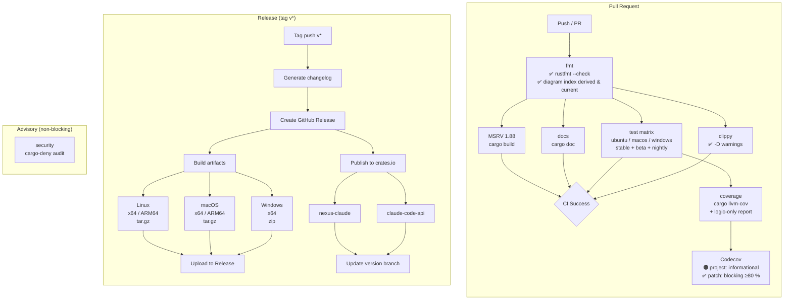

# CI/CD Pipeline

This document describes the continuous integration and deployment pipeline for Nexus.

## Overview

> **Source of truth**: [`docs/diagrams/nexus-ci-pipeline.mmd`](diagrams/nexus-ci-pipeline.mmd)
> — owned by the diagram index, verified on 2026-10-02.
> The inline copy below is rendered by GitHub for quick reference.



## Workflows

### CI Workflow (`ci.yml`)

Runs on every push and pull request to `main` and version branches.

#### Jobs

| Job | Description | Runs On |
|-----|-------------|---------|
| `fmt` | Check code formatting with rustfmt | ubuntu-latest |
| `clippy` | Run Clippy lints with `-D warnings` | ubuntu-latest |
| `test` | Run test matrix | ubuntu, macos, windows |
| `conformance` | The agent contract per provider, against its fake executable (see below) | ubuntu-latest |
| `coverage` | Generate code coverage report | ubuntu-latest |
| `docs` | Build documentation | ubuntu-latest |
| `security` | Run cargo-deny audit | ubuntu-latest |
| `msrv` | Verify MSRV (1.88) | ubuntu-latest |

#### Test Matrix

```yaml
strategy:
  matrix:
    os: [ubuntu-latest, macos-latest, windows-latest]
    toolchain: [stable, beta]
    include:
      - os: ubuntu-latest
        toolchain: nightly
```

#### Conformance per provider

The `conformance` job runs once per provider, with that provider's features only
(`--no-default-features --features testkit,<provider>`), against its fake executable.
A broken scenario turns the job named after the provider red.

| Job | Features | Tests | Fake |
|-----|----------|-------|------|
| `Conformance (claude-code)` | `testkit` | `claude_code_conformance` | `fake_claude` |
| `Conformance (native)` | `testkit,provider-native` | `native_conformance` | `fake_openai` + `fake_mcp` |
| `Conformance (codex)` | `testkit,provider-codex` | `codex_conformance` | `fake_codex` |
| `Conformance (acp)` | `testkit,provider-acp` | `acp_conformance`, `acp_conformance_matrix` | `fake_acp` |
| `Conformance (scripted)` | `testkit` | `agent_conformance` (the suite and its negative controls) | `ScriptedProvider` |

Locally: `cargo test -p nexus-claude --no-default-features --features testkit,provider-codex --test codex_conformance`.

#### Live tests (ignored, never in CI)

These need a real executable, a real machine, a key or the internet. They are `#[ignore]`d,
no CI job passes `--ignored`, and no workflow holds a secret for them. Run them by hand:

| Test | Needs | Command |
|------|-------|---------|
| `claude-code-sdk-rs/tests/codex_real.rs` | a real `codex` ≥ `MIN_APP_SERVER_VERSION` (`NEXUS_REAL_CODEX`, default `codex`) | `cargo test -p nexus-claude --features provider-codex --test codex_real -- --ignored` |
| `claude-code-sdk-rs/tests/codex_schema_drift.rs` (`real_codex_schema_still_names_everything_we_use`) | a real `codex` ≥ 0.130.0 (`CODEX_BIN`) | `cargo test -p nexus-claude --features provider-codex --test codex_schema_drift -- --ignored` |
| `claude-code-sdk-rs/tests/real_claude_gateway.rs` | the real `claude` CLI (no model call) | `cargo test -p nexus-claude --test real_claude_gateway -- --ignored --test-threads=1` |
| `claude-code-sdk-rs/tests/optimized_api_test.rs` | the real `claude` CLI, configured | `cargo test -p nexus-claude --test optimized_api_test -- --ignored` |
| `claude-code-sdk-rs/tests/claude_code_remote_real.rs` | a real machine over SSH (`NEXUS_REAL_REMOTE_HOST`, `_USER`, `_KEY`, `_IDENTITY`) | `cargo test -p nexus-claude --all-features --test claude_code_remote_real -- --ignored --nocapture` |
| `claude-code-sdk-rs/tests/native_context.rs` (two DeepSeek tests) | `DEEPSEEK_API_KEY` | `cargo test -p nexus-claude --features provider-native --test native_context -- --ignored --nocapture deepseek` |
| `claude-code-sdk-rs/tests/native_context.rs` (`reference_benchmark`) | nothing (a measurement) | `cargo test -p nexus-claude --features provider-native --test native_context -- --ignored --nocapture reference_benchmark` |
| `claude-code-sdk-rs/src/cli_download.rs` (one test) | the network | `cargo test -p nexus-claude --lib cli_download -- --ignored` |
| `nexus-tools/tests/native_browser.rs` | a real Obscura (`NEXUS_REAL_OBSCURA`) | `cargo test -p nexus-tools --features test-tools --test native_browser -- --ignored` |
| `nexus-tools/tests/web.rs`, `nexus-tools/tests/obscura_embedded.rs` (one each) | the internet | `cargo test -p nexus-tools --test web -- --ignored` |
| `claude-code-api` storage tests (`core/storage/*`, `neo4j_hook_callback.rs`) | a live Neo4j / Meilisearch | `cargo test -p claude-code-api -- --ignored` |

The other `#[ignore]`s of the repository are not live tests: each documents, in its reason string, a known bug or an
out-of-scope change (it passes once the fix lands), or a slow wait run on demand.

#### Mutation testing (manual, never in the required CI)

`cargo-mutants` changes the code one operator at a time and runs the tests; a mutant no test
fails on is a behaviour nothing pins. T3 ran it on the five zones where a wrong `<` or a deleted
`match` arm changes what the host sees or what the agent is allowed to do:

| Zone | Files |
|------|-------|
| Provider event mapping | `providers/claude_code/map_events.rs`, `providers/acp/map.rs`, `providers/codex/map.rs` |
| `ToolPolicy` decision | `agent/policy.rs`, `providers/native/policy_args.rs` |
| `tool_calls` assembly | `model/wire.rs` (stream deltas to `ToolCallChunk`) |
| Budget | `providers/native/loop.rs`: `spent_budget`, `budget_spent`, `budget_note`, `spend` |
| Retryable classification | `agent/error.rs` (and the `classify` functions of the codex and ACP maps) |

```sh
cargo install cargo-mutants --locked
# zones 1, 2, 3, 5: .cargo/mutants.toml. Unit tests only (a mutant is rebuilt in seconds):
cargo mutants -p nexus-claude --cargo-arg=--lib -j 2
# zone 4, the budget, is a slice of one file: .cargo/mutants-budget.toml. Its tests are integration tests:
cargo mutants -p nexus-claude --config .cargo/mutants-budget.toml -j 2 --cargo-arg=--lib \
  --cargo-arg=--test --cargo-arg=native_harness --cargo-arg=--test --cargo-arg=native_conformance \
  --cargo-arg=--test --cargo-arg=native_anthropic
# one file, or the survivors of a previous run only:
cargo mutants -p nexus-claude --cargo-arg=--lib -F 'providers/codex/map.rs'
cargo mutants -p nexus-claude --cargo-arg=--lib --iterate
```

Read `mutants.out/missed.txt`: it must be empty. `--cargo-arg=--lib` matters: without it
cargo-mutants rebuilds all ~80 test binaries for every mutant (minutes each). No CI job runs it: a run takes hours (one build and
one test run per mutant), and the token that pushes this repository cannot create a workflow file. A `timeout` counts as detected
(the mutant made a test hang); `unviable` mutants do not compile.

Result of the T3 pass (613 mutants listed, 60 unviable): with the tests that existed, **145** survived
(codex map 48, `policy_args` 46, ACP map 26, `model/wire.rs` 9, `map_events` 9, budget 6, `policy.rs` 1);
after it, **0** survive except the **5 equivalent mutants** excluded in `.cargo/mutants.toml`, each with
the reason it cannot be observed (an unreachable guard, a Windows-only operand, a leading `(`
that `split_into` ignores, a `glob_match` step that reaches the same state one iteration later).
Two things to know when you rerun it: the order of the printed names is not the order of the
files, and a line move in one of the 5 excluded spots needs the line numbers in `exclude_re` updated.

### Release Workflow (`release.yml`)

Triggered when a version tag (`v*`) is pushed.

#### Steps

1. **Create Release** - Generate changelog and create GitHub release
2. **Build Artifacts** - Build optimized binaries for all platforms
3. **Publish Crates** - Publish to crates.io in dependency order
4. **Update Branch** - Update the version branch (e.g., `v0.5`)

#### Artifacts

| Target | OS | Arch | Format |
|--------|-----|------|--------|
| `x86_64-unknown-linux-gnu` | Linux | x64 | tar.gz |
| `aarch64-unknown-linux-gnu` | Linux | ARM64 | tar.gz |
| `x86_64-apple-darwin` | macOS | x64 | tar.gz |
| `aarch64-apple-darwin` | macOS | ARM64 | tar.gz |
| `x86_64-pc-windows-msvc` | Windows | x64 | zip |

## GitHub Actions

### Composite Actions

#### `setup-rust`

Reusable action for Rust toolchain setup with caching.

```yaml
- uses: ./.github/actions/setup-rust
  with:
    toolchain: stable
    components: clippy, rustfmt
    targets: aarch64-unknown-linux-gnu
```

## Secrets Required

| Secret | Description | Used In |
|--------|-------------|---------|
| `CARGO_REGISTRY_TOKEN` | crates.io API token | release.yml |
| `CODECOV_TOKEN` | Codecov upload token | ci.yml |

## Branch Protection

### `main` Branch

- Require pull request before merging
- Require status checks to pass:
  - `fmt`
  - `clippy`
  - `test`
  - `docs`
  - `msrv`
- Require linear history (squash merge)

### `v*` Version Branches

- Require status checks to pass
- Allow direct push for hotfixes

## Quality Gates

### Required Checks

1. **Format** - Code must be formatted with rustfmt
2. **Lints** - No Clippy warnings
3. **Tests** - All tests pass on all platforms
4. **MSRV** - Builds with Rust 1.88

### Advisory Checks

1. **Coverage** - Patch gate blocks at ≥ 80 % (lines changed by a PR must be covered);
   project-wide gate is informational until baselines are raised
   (sdk ≈ 69 %, api ≈ 39 % measured with `--ignore-filename-regex` on tests/examples).
   A second patch gate, `agent-contract`, blocks at ≥ 90 % on `claude-code-sdk-rs/src/agent/**` and
   `claude-code-sdk-rs/src/providers/*/map_events.rs`.
2. **Security** - cargo-deny audit (advisory only)

## Local Development

### Running CI Checks Locally

```bash
# Format
cargo fmt-nexus -- --check   # the nexus crates; --all would include the vendored obscura/

# Clippy
cargo clippy --all-targets --features "$(scripts/nexus-features.sh)" -- -D warnings

# Tests
cargo test --features "$(scripts/nexus-features.sh)"

# Doc tests
cargo test --doc --features "$(scripts/nexus-features.sh)"

# Documentation
cargo doc --features "$(scripts/nexus-features.sh)" --no-deps

# Security audit
cargo deny check
```

### Pre-commit Hook

Consider adding a pre-commit hook:

```bash
#!/bin/sh
cargo fmt-nexus -- --check   # the nexus crates; --all would include the vendored obscura/
cargo clippy --all-targets --features "$(scripts/nexus-features.sh)" -- -D warnings
cargo test --features "$(scripts/nexus-features.sh)"
```

## Troubleshooting

### CI Failures

| Issue | Solution |
|-------|----------|
| Format check fails | Run `cargo fmt-nexus` locally |
| Clippy warnings | Fix warnings or add `#[allow(...)]` with justification |
| Test failures | Check test output, run locally with `--nocapture` |
| MSRV failure | Check for features requiring newer Rust |

### Release Failures

| Issue | Solution |
|-------|----------|
| crates.io publish fails | Check token validity, version conflicts |
| Cross-compilation fails | Check target toolchain availability |
| Changelog generation fails | Verify conventional commit format |
